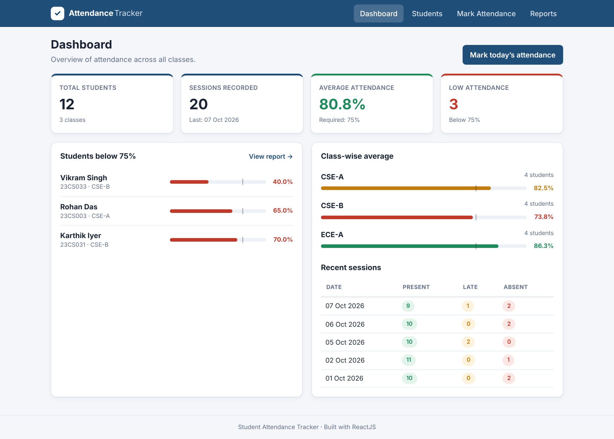
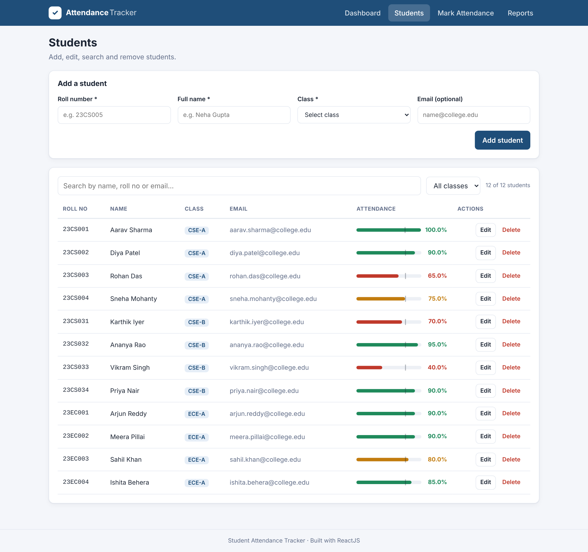
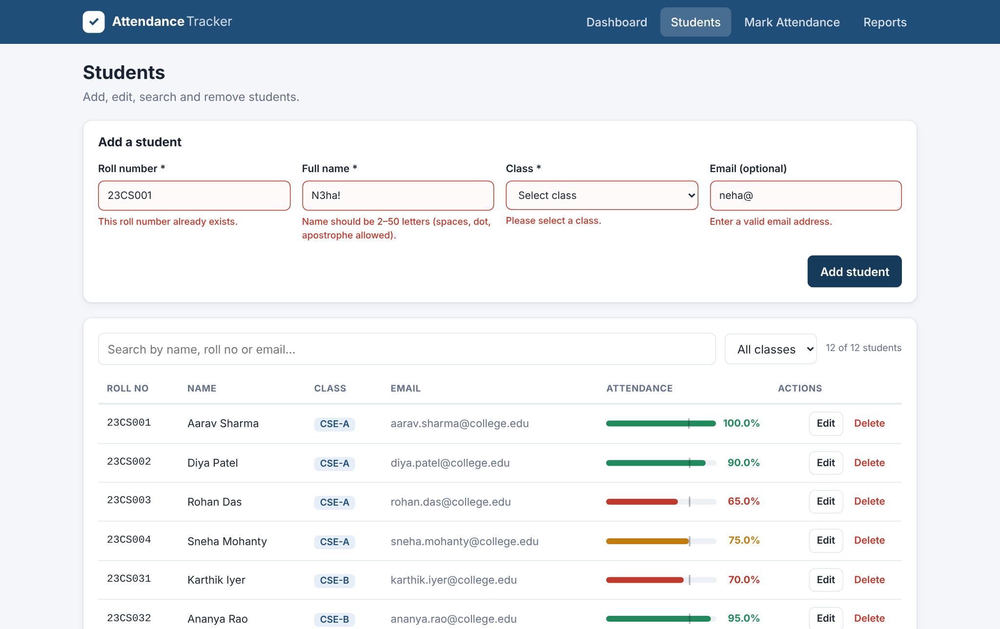
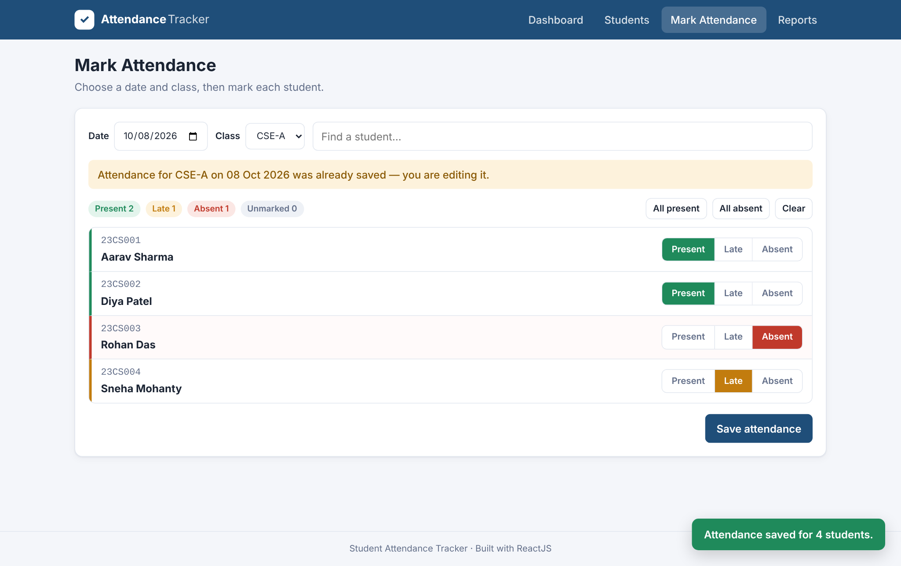
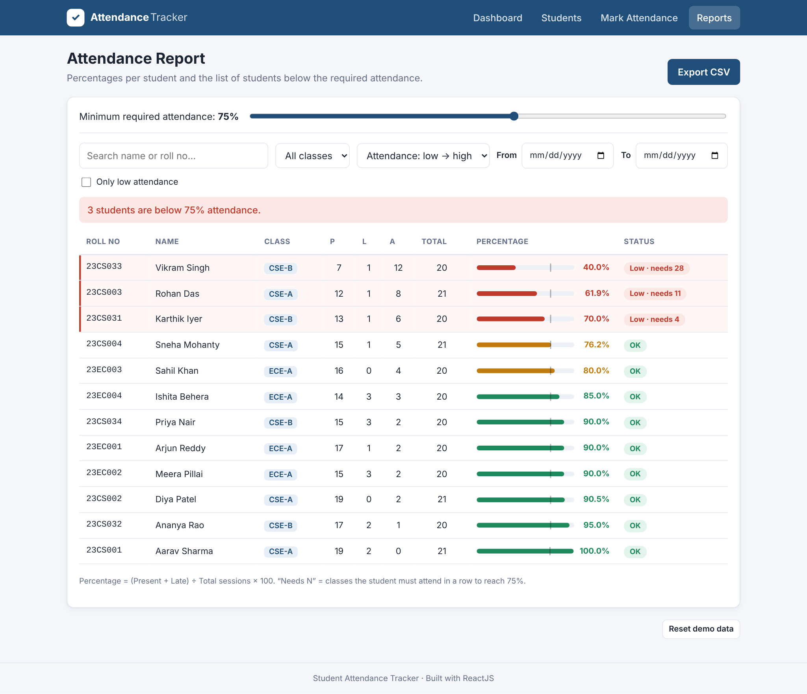
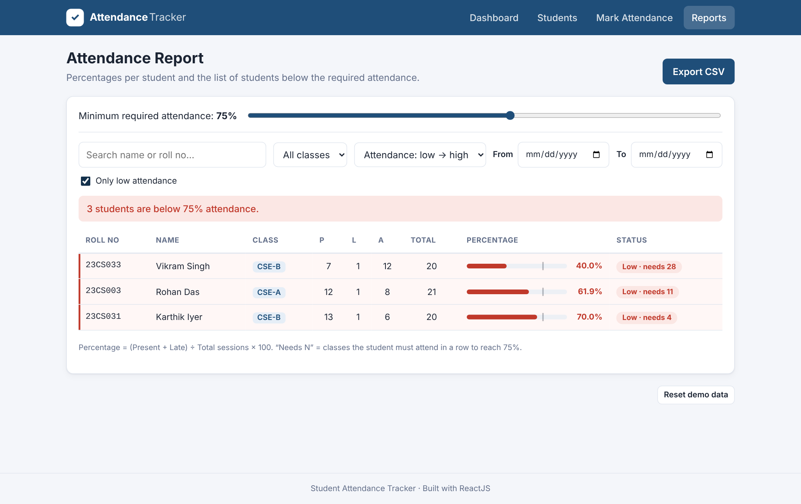
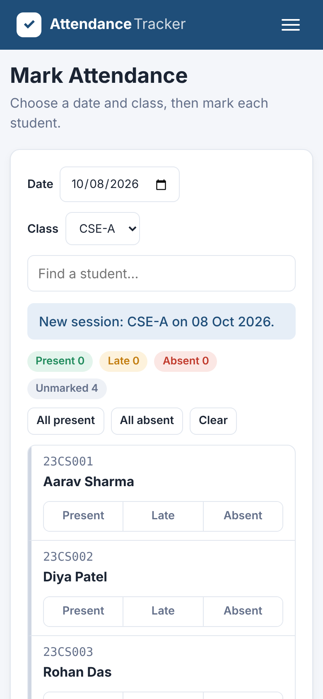

# Student Attendance Tracker (ReactJS)

An interactive, responsive ReactJS application to **record student attendance**, **calculate attendance percentages**, and **display students with low attendance**.

> GitHub repository: `https://github.com/<your-username>/student-attendance-tracker`



---

## Features

| Area | What it does |
|---|---|
| **Dashboard** | Total students, sessions recorded, average attendance, number of low-attendance students, class-wise averages, recent sessions |
| **Students** | Add, edit, delete students; search by name / roll no / email; filter by class; form validation |
| **Mark Attendance** | Pick a date + class, mark each student Present / Late / Absent, bulk "All present / All absent", live counts, edit an existing session |
| **Reports** | Attendance % per student, adjustable threshold slider (50–95 %), "only low attendance" filter, date-range filter, sort, search, CSV export, "classes needed to recover" |
| **Persistence** | Data is saved in the browser's `localStorage`, so it survives page refreshes |
| **Responsive** | Works on desktop, tablet and mobile (hamburger menu, stacked layouts) |

### Client-side validation
- Roll number: required, 4–10 letters/digits, must be unique
- Name: required, 2–50 letters (spaces, dot, apostrophe allowed)
- Class: required
- Email: optional, but must be a valid format
- Attendance: date required and not in the future, every student must be marked before saving
- Report: "From" date cannot be after "To" date

### Attendance formula
```
Percentage = (Present + Late) ÷ Total sessions × 100
Classes needed = ceil((T × total − attended) ÷ (1 − T))   where T = threshold / 100
```
A student is **low** when their percentage is below the threshold (default **75 %**).

---

## Tech stack
- **ReactJS 18** – functional components, JSX, `useState`, `useEffect`, `useMemo`, Context API
- **React Router 6** – client-side routing between 4 pages (+ 404)
- **HTML5 / CSS3** – semantic markup, CSS variables, Flexbox, Grid, media queries
- **JavaScript ES6+** – arrow functions, destructuring, spread, template literals, modules, `Array` methods
- **Vite** – dev server and build tool

---

## Project structure

```
student-attendance-tracker/
├── index.html
├── package.json
├── vite.config.js
├── public/
│   └── favicon.svg
├── screenshots/                 # application screenshots
├── docs/
│   ├── Student_Attendance_Tracker.pptx   # 8-slide presentation
│   └── WORKFLOW.md                       # workflow explanation
└── src/
    ├── main.jsx                 # entry point: BrowserRouter + AttendanceProvider
    ├── App.jsx                  # layout + routes
    ├── context/
    │   └── AttendanceContext.jsx  # global state, localStorage sync (useEffect), actions
    ├── data/
    │   └── sampleData.js        # demo students + generated attendance
    ├── utils/
    │   └── attendance.js        # % calculation, validation, CSV export helpers
    ├── components/
    │   ├── Navbar.jsx           # responsive navigation
    │   ├── StudentForm.jsx      # add/edit form with validation
    │   ├── StatCard.jsx         # dashboard summary card
    │   ├── ProgressBar.jsx      # colour-coded % bar with threshold marker
    │   ├── ConfirmDialog.jsx    # delete confirmation modal
    │   ├── EmptyState.jsx
    │   └── Toast.jsx            # success / info messages
    ├── pages/
    │   ├── Dashboard.jsx
    │   ├── Students.jsx
    │   ├── MarkAttendance.jsx
    │   ├── Reports.jsx
    │   └── NotFound.jsx
    └── styles/
        └── App.css
```

---

## Application workflow

1. **Open the app → Dashboard.** On first launch, 12 demo students in 3 classes (CSE-A, CSE-B, ECE-A) with 20 days of attendance are loaded. The dashboard shows totals, the average attendance, class-wise averages and the list of students below 75 %.
2. **Manage students (Students page).** Fill in roll number, name, class and email and click **Add student**. Invalid input shows inline error messages and blocks saving. Use **Edit** to load a student back into the form and **Save changes**, or **Delete** (with a confirmation dialog) to remove a student and their records. The search box and class filter narrow the table instantly.
3. **Record attendance (Mark Attendance page).** Choose a date (today by default) and a class. Mark each student **Present / Late / Absent**, or use **All present** and then change the exceptions. Live counters show how many are present, late, absent and unmarked. Click **Save attendance** — the app checks that the date is not in the future and that everyone is marked. Choosing a date that was already saved loads it for editing.
4. **Calculations update automatically.** Every saved change updates React state, which re-computes each student's present/late/absent counts and percentage, and `useEffect` writes the data to `localStorage`.
5. **Review reports (Reports page).** See each student's P / L / A / total and percentage with a colour-coded bar. Move the **threshold slider** to change the required percentage, tick **Only low attendance** to list defaulters, filter by class or date range, sort, and **Export CSV**. Low students show how many consecutive classes they need to attend to recover.

```
Add students ──► Mark attendance (date + class) ──► Save
       ▲                                              │
       │                                              ▼
  Edit / delete ◄── Reports & Dashboard ◄── % calculated per student
                    (low-attendance list)
```

---

## Getting started

Requires **Node.js 18+**.

```bash
npm install
npm run dev        # open http://localhost:5173
```

Production build:

```bash
npm run build
npm run preview    # serves the built app on http://localhost:4173
```

To start over with the demo data, click **Reset demo data** at the bottom of the Reports page.

---

## Screenshots

| | |
|---|---|
|  Students list |  Form validation |
|  Marking attendance |  Attendance report |
|  Low-attendance filter |  Mobile view |

---

## Publishing to GitHub

```bash
git remote add origin https://github.com/<your-username>/student-attendance-tracker.git
git branch -M main
git push -u origin main
```
